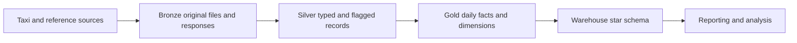

# Learn the project step by step

Start with the [report](../reports/project_report.html) and the [two real examples](../reports/trace_example.json). Work through each lesson in order. For each step, ask what comes in, what the code changes, what comes out, and how you can check it. Use the [seven-minute breakdown script](demo_script.md) when you can explain the examples yourself.

## 1. The question you are answering

The project turns public source records into an analysis of NYC taxi demand, measured air quality, and economic context. You can use the outputs to answer where and when yellow taxi pickups happened, how recorded USD charges translate to EUR, and how daily pickup counts and monitored pollution moved together in selected zones.

Data engineering is the work that makes those answers repeatable. It includes obtaining the records, keeping evidence of what arrived, deciding which values can be compared, building tables with clear keys, and checking the results before publishing them.

| Source | What one source record represents | What it adds |
| --- | --- | --- |
| NYC TLC Yellow Taxi | One reported trip in a monthly Parquet file | Pickup time and zone, distance, fare and total charge |
| NYC Taxi Zones | One lookup row or one zone geometry | Names for trip zone IDs and geographic boundaries for monitors |
| OpenAQ | One measurement or time interval for a sensor | Station readings, including fine particles (`pm25`) and ozone (`o3`) |
| European Central Bank | One dated rate or observation | US dollars per euro |
| World Bank | One annual observation for a country and indicator | US GDP in current dollars |

Parquet is a column-oriented file format. A large trip table can be read one set of columns at a time. CSV is a text table. JSON can hold nested data such as API results and pagination metadata. An API is a service you request over the network. The local demo takes OpenAQ data from its public compressed CSV archive. The course design calls the authenticated API through Dataflow Gen2. [TLC trip records](https://www.nyc.gov/site/tlc/about/tlc-trip-record-data.page), [OpenAQ archive](https://docs.openaq.org/aws/about), [ECB rates](https://www.ecb.europa.eu/stats/policy_and_exchange_rates/euro_reference_exchange_rates/html/index.en.html), [World Bank GDP indicator](https://data.worldbank.org/indicator/NY.GDP.MKTP.CD).

## 2. Know the path from download to report

**Bronze** keeps the source bytes and run metadata. **Silver** reads those bytes, standardizes types and time, and makes quality problems visible. **Gold** groups comparable records for reporting. This pattern is called a medallion architecture. The local report reads its Gold equivalents from DuckDB. In the Fabric design, the Gold tables also feed the Warehouse for SQL reporting.

**Fabric workspace** is where your course items would live. **OneLake** is the Fabric storage layer. A **Lakehouse** exposes files and tables on that storage. The PySpark **notebooks** transform tables written in **Delta**, a table format with a transaction log. The **Warehouse** provides the SQL reporting model. A **Dataflow Gen2** uses Power Query to ingest an API feed. A **pipeline** starts and coordinates activities and passes parameters between them. These roles explain why one notebook alone would cover only part of the brief. [Microsoft Fabric fundamentals](https://learn.microsoft.com/en-us/fabric/fundamentals/).

## 3. Bronze preserves evidence

The local source check downloads a TLC file, the zone lookup, World Bank GDP and ECB FX. It validates basic shapes and puts the original responses in the cache. The OpenAQ archive command lists available dated objects for the three reviewed stations, saves the original gzip files, and checks station IDs, coordinates and data format. It also keeps the official GeoJSON used to assign station zones. Find the download logic in [preflight.py](../src/fabric_project/preflight.py) and [openaq_archive.py](../src/fabric_project/openaq_archive.py).

[bronze.py](../src/fabric_project/bronze.py) gives each source version a **SHA-256 checksum**, a reproducible fingerprint of the exact bytes. A **manifest** records the checksum, URL, timestamp, run ID and storage path. Downloading the same bytes can reuse the saved file. A revised source can coexist with the earlier version. Before analysis the build checks the hashes against the manifest. [June 2025 run evidence](../reports/local_build.json).

**Explain it aloud.** “If a value looks surprising, I can trace it back to exactly which file I downloaded. Silver never has to guess which version of the raw file it used.”

## 4. Silver makes records usable and traceable

Open [the taxi trace](../reports/trace_example.json) and read `source_and_silver`. The zero-based file row 158 has a New York pickup time of **June 1, 2025 at 00:41:47**, TLC pickup zone **209 (Seaport)**, a distance of **0 miles**, **$37.50** base fare, and **$39.00** total charged.

Silver derives `pickup_date = 2025-06-01` and `pickup_hour = 0`, stores the amounts as decimals, adds the `zero_distance` quality flag, and keeps the row. A flag marks a condition to inspect. The instructor specifically said to preserve zero-distance taxi records. There are many possible reasons for them, and this record carries a charge. Also distinguish zero from a null, which represents an unknown or unavailable value. Inspect [local_taxi_silver.sql](../sql/local_taxi_silver.sql) and the corresponding [Fabric taxi notebook source](../notebooks/source/02_taxi_silver.py).

The June 2025 file has **4,322,960** source rows and the same number in Silver. **4,322,940** fall within the declared report dates. The other **20** have out-of-window pickup dates and remain in Silver. There are **134,896** zero-distance records inside the published window. The reporting filters and quality flags make those decisions visible.

In air Silver, the key is a sensor and its UTC interval start. A reading ending July 1 at local midnight describes 11 p.m. on June 30, so it counts toward June. The job reads the July 1 archive object to capture this boundary hour. UTC identifiers also distinguish repeated fall-back hours during daylight saving. Exact repeats are counted and deduplicated. Conflicting values for the same sensor and UTC hour stop the run. Negative and nonfinite air readings stay available for quality review and are excluded from air means. The public archive omits the upstream flag field, so the local run records that state as unknown and applies structural checks. The API path expects an explicit upstream flag state. [OpenAQ time-ending convention](https://docs.openaq.org/using-the-api/dates-datetimes).

## 5. Gold answers how much and how often

**Grain** means precisely what one row stands for. Establish it before writing a join. A **fact** records measured activity at its grain. A **dimension** provides a unique lookup key and descriptive context. Grouping means combining detailed records into one row per chosen key. An aggregate is a calculated value such as a sum, count, or average.

| Reporting table | One row represents | Measure or use |
| --- | --- | --- |
| `FactTaxiDaily` | A pickup date and zone | Trip count, sum of fares and charges, zero-distance count, number of known values |
| `FactAirQualityDaily` | A local date, station, pollutant and unit | Observed hours and mean concentration |
| `DimDate` | A calendar date | Year, month and day of week |
| `DimZone` | A TLC zone ID | Zone name, borough and service area |
| `DimFX` | A calendar date and currency pair | Effective rate, actual source rate date and its age |
| `DimGDP` | A country, year and GDP indicator | Nominal US GDP |
| `DimAirLocation` | An OpenAQ station ID | Station name, coordinates and reviewed TLC zone |

In the Seaport example, Gold adds the row's one trip and $39.00 charge to the June 1/zone 209 group. That group has **409 trips**, **5 flagged zero-distance trips** and **$11,014.59** in recorded total charges. An average base fare uses summed base fares divided by trips with known base fare. The total charge is a different source field. See [local_gold.sql](../sql/local_gold.sql), [the data dictionary](data_dictionary.md) and [the Warehouse table definitions](../warehouse/01_create_star.sql).

## 6. Currency and GDP use different calendars

The ECB quote is **USD per EUR**. Divide USD by that rate to express the same amount in euros. For June 1, 2025, the latest available reference rate was **1.1339** from Friday, May 30. The age is two days. Dividing the Seaport group's $11,014.59 by 1.1339 gives approximately **€9,713.90**. The project uses a maximum seven-day lookback and preserves each matched source date so the rate choice is auditable. A charge without eligible FX remains in USD with no EUR value. For the comparison chart, use USD and EUR totals based on the same FX-eligible charges.

GDP describes the annual US economy in current dollars. A calendar year can label taxi observations with context, but summing a year's GDP after attaching it to every day or zone would multiply the annual value. In the chart, GDP stays at its original annual grain.

## 7. Join the two types of evidence at the right grain

Joining means matching rows by named keys. Imagine a zone has 188 taxi records and 24 readings. Matching the two unaggregated tables by day and zone can yield **4,512** combinations. That is why the project computes the daily taxi count and daily air mean separately first.

The PM2.5 monitor **CCNY** (station 384) lies in **Manhattanville**, zone 152, based on the official NYC Taxi Zone polygons. On June 1 it recorded 24 eligible hourly values with a sum of **81.7**. Its daily mean was **81.7 ÷ 24 = 3.4042 µg/m³**. The daily taxi fact has **188 pickups** for that same date and zone. Joining these daily facts produces one pair for PM2.5. With several stations in one zone, the code averages eligible station means before that join. [CCNY station metadata](https://explore.openaq.org/locations/384), [NYC Taxi Zone boundaries](https://data.cityofnewyork.us/Transportation/NYC-Taxi-Zones/8meu-9t5y/data_preview), [actual pair in the trace](../reports/trace_example.json).

The report uses a minimum of **18 observed hours** to admit a station-day to correlation. That is a project coverage choice. Lower-coverage days stay visible in pollution charts. The code calculates a Pearson correlation coefficient for each zone, pollutant and unit when there are at least three paired days and both variables vary. A coefficient near +1 indicates a stronger positive linear association. A coefficient near -1 indicates a stronger negative linear association. Near zero indicates little linear association. Each coefficient describes the measured sample. Weather, traffic composition, regional smoke and other factors can influence the patterns. The project measures three zones and two June windows.

The 2025 run produced **148 matched date–zone–pollutant series rows** across five series. For Manhattanville PM2.5, June 2025 gives **30 paired days** and **r ≈ +0.373**. June 2024 gives **28 paired days** and **r ≈ -0.218**. Report the date range and sample size alongside either value. Repeating what the scatterplot actually shows is a stronger answer than assigning a cause. [June 2025 pairs and coefficients](../reports/tables/air_taxi_correlation.csv), [comparison run](../reports/comparison_build.json).

## 8. Verification, automation and implementation files

**Reconciliation** compares independently computed counts and totals. The build compares source and Silver row counts, accounts for June and out-of-window records, and verifies the sum of published trip counts and money against the eligible Silver rows. It checks that date and zone references resolve and that FX rates are neither future-dated nor stale.

A **rerun** reads the same input versions and rebuilds the tables. Each month passed exact comparisons of sorted reporting-table fingerprints. During development, parallel floating-point correlation caused insignificant variation in the final digits. The build now specifies an accumulation order and runs the local environmental calculations in one thread, then compares the full reporting outputs again. A failed build writes an error but leaves the previous success pointer in place. Inspect the timestamps and statuses in the [run evidence](../reports/local_build.json) and review the [unit-test log](../reports/test_results.txt).

The local runner launches the source captures, both builds, the report generator and asset checks in dependency order. The [Fabric master pipeline specification](../pipelines/master.spec.json) starts the independent source feeds, runs their Silver and Gold notebooks, publishes and verifies the Warehouse, then refreshes visualizations. Source cadences differ. Taxi data is monthly, FX follows published observation dates, GDP can be revised, and air data arrives at higher frequency. A controller should advance the relevant checkpoint only on success. [Lineage and governance](lineage_and_governance.md).

| File or folder | When to open it |
| --- | --- |
| [tools/run_local_demo.py](../tools/run_local_demo.py) | Show the local sequence from downloads to report |
| [src/fabric_project/local_build.py](../src/fabric_project/local_build.py) | Show the lock, stage log, validations, rerun and success publication |
| [src/fabric_project/local_air.py](../src/fabric_project/local_air.py) | Show air coverage, daily means and the date/zone join |
| [notebooks](../notebooks/) | Show the six Fabric Python notebooks, from Bronze inspection to visualizations |
| [dataflows](../dataflows/) | Show the three API ingestion queries and how destinations would be connected |
| [warehouse](../warehouse/) | Show table definitions, load, checks and analytical SQL |
| [requirements.md](requirements.md) | Show exactly which assignment components have local evidence and which need a Fabric run |

Governance in this project means recording where data came from, protecting credentials outside Git, restricting who can change publication settings, and retaining enough evidence to reconcile or recover from a failed run. Source control records changes to logic and instructions. Small reporting evidence is tracked. Raw files, scratch databases and secrets belong outside the repository.

**Extensibility** is the ability to add a source without rewriting the existing ones. If you were assigned weather as an extension, you would add its own collector and Bronze input, then define fields such as station, time, temperature and unit in Silver. You would choose a common date and zone grain for Gold before connecting it to the analysis. The same pipeline can add an independent ingest branch and then wait for its validated output. This is the design you can explain when asked how a future integration would fit.

## 9. What you can demonstrate today

Open [the dashboard](../reports/project_report.html), then show the [real row trace](../reports/trace_example.json) and the [run checks](../reports/local_build.json). DuckDB calculated and verified the data behind the dashboard. The June 2024 and June 2025 runs use comparable station series. The two snapshots support a same-month comparison. Sustained trends require more overlapping history.

The Fabric notebooks are Python source packaged in standard `.ipynb` files. You can write, inspect and syntax-check them without a licensed workspace. A Fabric execution still has to prove attached Lakehouse paths, Delta writes, authenticated OpenAQ Dataflow refresh, Warehouse loads and the scheduled pipeline. The public archive demonstrated the local OpenAQ workflow. Live grading of the Fabric requirements needs a capacity-backed workspace and the required connections. Follow [Fabric setup](fabric_setup.md) when they are available.

## Check your understanding

1. What does one row mean in Silver taxi, Gold taxi and Gold air?
2. Why can a zero-distance taxi record still change the money total?
3. Why is a USD-to-EUR conversion a division in this project?
4. What prevents one weather or air measurement from multiplying taxi counts in an analysis?
5. How can you show that rerunning the same month did not change the tables?
6. What has been proved locally, and what should an instructor still see running in Fabric?

Check your answers

1. One source trip, one date and pickup zone, and one date/station/pollutant/unit, respectively.
2. The source can record a valid charge even when distance is zero. The Seaport example contributes $39.00.
3. The rate counts dollars per euro. Dividing dollars by dollars per euro leaves euros.
4. Aggregate each input to a declared grain and join on aligned keys. Here the analysis uses the same date, zone and eligible pollutant series.
5. Read both successful stage logs and compare fingerprints covering the sorted reporting tables. Also check the exact count and money reconciliations.
6. Both real-data months, local calculations and reporting ran and reconciled. Fabric items were authored and checked offline. Cloud workspaces, connections, refreshes, notebook execution and publication still need live run evidence.

