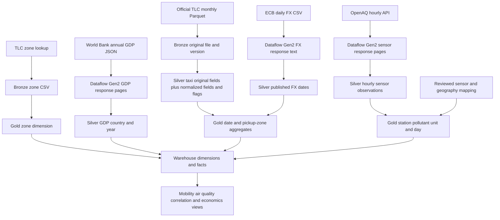

# Data lineage and operational policies

## Data journey

This diagram describes the required Fabric deployment. Local verification currently substitutes a local database for execution evidence, while keeping the intended source-to-report transformations explicit. `reports/local_build.json` records the executed local stages and checksums.

## Ownership and access

The project owner maintains ingestion, transformations, and data definitions. Course reviewers receive only the workspace/report access needed for assessment. Public publishing is a separate decision. Do not enable broader sharing to work around capacity or credential problems.

Fabric connections hold credentials through a verified secure mechanism. Keys never belong in committed M code, notebooks, ordinary configuration files, URL query strings, logs, or screenshots. The local API helper reads an ephemeral environment variable and logs no request headers. API 401/403 failures require credential correction; repeated retries are inappropriate.

## Retention and provenance

Retain the exact source versions used in any published analysis, their URLs, request parameters, retrieval timestamps, SHA-256 hashes, and transformation Git revision. Keep revised raw payloads alongside prior versions. Source revisions produce a new downstream run and require reconciliation before replacing reporting results.

Raw and Silver retention must cover the assessment/reproduction period. A final retention duration requires a workspace storage decision; none has been silently imposed. Delete data only through an intentional retention procedure after confirming it is no longer needed to reproduce the submitted result.

## Quality and interpretation

Zero distance, zero fare, negative fare, missing values, and invalid timestamps are distinct conditions. Retain source fields and explicit flags. Reporting exclusions require reason counts that reconcile with Silver. An unusual value is not sufficient evidence that a record is invalid.

OpenAQ records are eligible for the daily mean only when the declared hourly interval, location mapping, pollutant/unit, finite nonnegative value, and upstream status support it. Exact duplicate observations are counted and traceable in Bronze. Conflicting observations for one sensor/hour fail visibly. The station/hour aggregation weights eligible sensors equally; the station/day mean weights observed hours equally. Missing hours are not zeros. Compare observations in the same pollutant/unit and show coverage.

The UTC interval is retained to distinguish repeated local hours during daylight-saving transitions. Taxi source times without offsets retain their wall-clock meaning; precise elapsed duration around DST requires additional provenance and is disclosed as a limitation.

Taxi counts are a proxy for recorded Yellow Taxi activity, not a measurement of all road traffic. A monitor represents its measured location, not uniform conditions across a borough or city. One month cannot answer seasonal or multi-year questions, and two annual GDP values alone do not support reliable macroeconomic correlation.

EUR conversion divides USD by the USD-per-EUR rate and uses only an available preceding reference rate no more than seven days old. Retain source rate date and age. GDP is national annual nominal GDP; do not sum it across daily rows or claim it is NYC GDP.

## Publication and failure handling

Local publication changes its latest-success pointer only after validation. Warehouse publication uses an explicit transaction across the reporting tables, checks grains and references, then compares totals before commit. A missing environmental input blocks full core publication. Do not run concurrent Gold writers while the Warehouse batch reads it.

Fabric Delta writes, SQL endpoint synchronization, transaction behavior, scheduled credentials, and pipeline retries still require actual cloud execution. The local failure/recovery tests prove the local runner's behavior only. The platform supports explicit cross-database transactions within a workspace; see [Microsoft's transaction documentation](https://learn.microsoft.com/en-us/fabric/data-warehouse/transactions).

## Extending the project

Add a source adapter that emits Bronze records with the same provenance fields, define the Silver contract and quality rules, add Gold grain and reporting mappings, connect the pipeline dependencies, and test reruns plus schema changes. Keep existing adapters independent. Weather and quality-report bots remain separate-grade work after the core passes.
