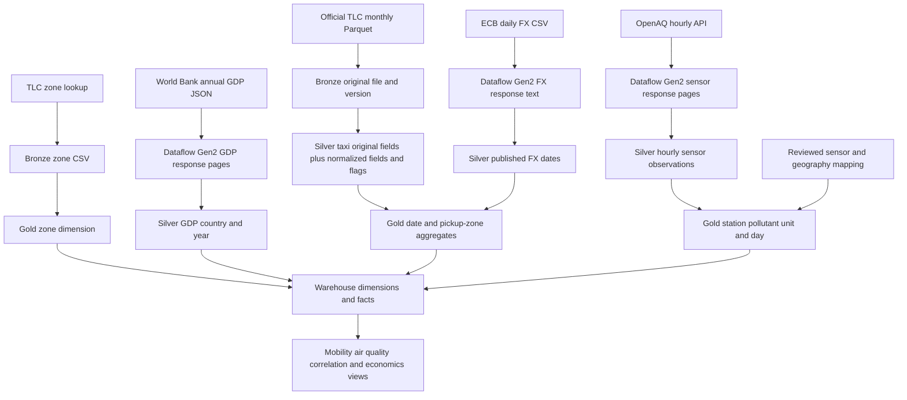
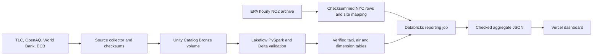

# Data lineage and operational policies

## Data journey

This diagram describes the Fabric deployment. The local implementation uses the public OpenAQ gzip archive and DuckDB. Station coordinates are matched to official NYC Taxi Zone polygons. The June 2025 and June 2024 run evidence records which stages executed and which inputs they used. [OpenAQ archive](https://docs.openaq.org/aws/about), [NYC Taxi Zones](https://data.cityofnewyork.us/Transportation/NYC-Taxi-Zones/8meu-9t5y/data_preview).

## Databricks and Vercel lineage

The submitted Databricks and Vercel workflow follows this verified path.

The dataset checks and immutable next version protect the last successful output. Vercel serves aggregates from the last export. The Databricks trial reached World Bank during the source connectivity check. The external collector handles the remaining feeds. One scheduled build succeeded using the staged files. The recurring job is paused. [Run evidence](../reports/refresh_evidence.json).

## Ownership and access

The project owner maintains ingestion, transformations, and data definitions. Course reviewers receive only the workspace/report access needed for assessment. Public publishing is a separate decision. Do not enable broader sharing to work around capacity or credential problems.

The production dashboard and Git repository expose reporting aggregates and sanitized evidence. Workspace authentication, Databricks source rows, trial settings, and original course materials stay outside the public deployment.

Fabric connections hold credentials through a verified secure mechanism. Keys never belong in committed M code, notebooks, ordinary configuration files, URL query strings, logs, or screenshots. The local API helper reads an ephemeral environment variable and logs no request headers. API 401/403 failures require credential correction; repeated retries are inappropriate.

## Retention and provenance

Retain the exact source versions used in any published analysis, their URLs, request parameters, retrieval timestamps, SHA-256 hashes, and transformation Git revision. Keep revised raw payloads alongside prior versions. Source revisions produce a new downstream run and require reconciliation before replacing reporting results.

Raw and Silver retention must cover the assessment/reproduction period. A final retention duration requires a workspace storage decision; none has been silently imposed. Delete data only through an intentional retention procedure after confirming it is no longer needed to reproduce the submitted result.

## Quality and interpretation

Zero distance, zero fare, negative fare, missing values, and invalid timestamps are distinct conditions. Retain source fields and explicit flags. Reporting exclusions require reason counts that reconcile with Silver. An unusual value is not sufficient evidence that a record is invalid.

OpenAQ records require a valid hourly interval, location mapping, pollutant and unit, and a finite, nonnegative value. The authenticated feed also requires explicit upstream flag status. The archive omits that field, so local provenance records unknown upstream flag status. Exact duplicates are counted and traceable in Bronze. A conflict for one sensor and hour stops the run. A station hour weights eligible sensors equally. A station day weights eligible hours equally. The analysis keeps pollutant/unit combinations separate and needs 18 observed hours per station-day to pair with taxi records.

The UTC interval is retained to distinguish repeated local hours during daylight-saving transitions. Taxi source times without offsets retain their wall-clock meaning; precise elapsed duration around DST requires additional provenance and is disclosed as a limitation.

Taxi counts represent recorded Yellow Taxi pickups. A monitor represents conditions at its location. The two June windows support a same-month comparison for the monitored sites. Seasonal or macroeconomic analysis requires more data.

EUR conversion divides USD by the USD-per-EUR rate and uses only an available preceding reference rate no more than seven days old. Retain source rate date and age. GDP is national annual nominal GDP; do not sum it across daily rows or claim it is NYC GDP.

## Publication and failure handling

Local publication changes its latest-success pointer only after validation. Warehouse publication uses an explicit transaction across the reporting tables, checks grains and references, then compares totals before commit. A missing environmental input blocks full core publication. Do not run concurrent Gold writers while the Warehouse batch reads it.

Fabric Delta writes, SQL endpoint synchronization, transaction behavior, scheduled credentials, and pipeline retries still require actual cloud execution. The local failure/recovery tests prove the local runner's behavior only. The platform supports explicit cross-database transactions within a workspace; see [Microsoft's transaction documentation](https://learn.microsoft.com/en-us/fabric/data-warehouse/transactions).

## Extending the project

Add a source adapter that emits Bronze records with the same provenance fields, define the Silver contract and quality rules, add Gold grain and reporting mappings, connect the pipeline dependencies, and test reruns plus schema changes. Keep existing adapters independent. Weather and quality-report bots remain separate-grade work after the core passes.
