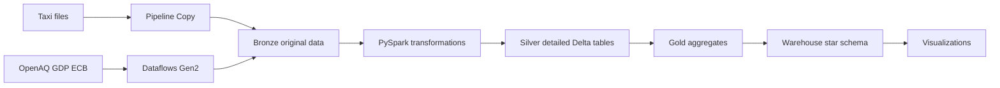

# Explain the project step by step

Use [the full lesson](learn_project.md) to study how the completed local runs work. The diagram here shows the Fabric deployment path.

## Opening

"I am building an analytics platform in Microsoft Fabric that combines taxi activity, air quality, GDP, and exchange rates. The purpose is to compare mobility with environmental patterns and express taxi charges in different currencies. I preserve original data, prepare consistent tables, and organize reporting results into facts and dimensions."

## Follow the data

This is the target architecture, not a claim of current deployment. Consult requirements.md for status.

## Step 1 Sources

"Taxi files describe recorded trips. OpenAQ describes sensor measurements. GDP supplies annual national context. ECB supplies daily published currency rates. They have different dates, locations, units, and refresh frequencies, so I cannot simply join all raw rows."

Show `config/project.json` and the reviewed stations in `config/air_stations.json`. The two local runs verify June 2025 and June 2024 measurements for those stations.

## Step 2 Bronze and evidence

"I preserve the exact downloaded bytes and calculate a SHA-256 checksum. Identical downloads reuse the same stored payload; changed source content gets a different file. Each run has its own manifest so I can trace where a value came from."

Show `src/fabric_project/bronze.py` and the latest source-check report. Distinguish this local verification tool from the required Fabric Pipelines and Dataflows.

Question: Why keep raw data? Answer: to reproduce transformations, inspect suspicious records, and recover from a faulty transformation without relying on an unchanged upstream source.

## Step 3 Inspect before cleaning

Open notebook 01. Read the source schema, row count, zero-distance count, missing-fare count, and date range. The actual local Parquet profile found **4,322,960 records** in the June 2025 delivery. **134,896** had zero recorded distance; **109,304** of those had a positive base fare. One example recorded **$37.50** in base fare and **0 miles**. This shows why a zero-distance filter would change financial reporting. It does not explain what happened on that particular trip. See [the measured profile](../reports/taxi_profile.json). Confirm the counts independently once the Fabric notebook executes.

Question: Are zero-distance trips errors? Answer: not necessarily. A meter can record charges even if the vehicle does not travel. I retain those records and flag them for investigation.

## Step 4 Silver transformation

Open notebook 02. Walk through its cells in order: source contract, standardized fields, quality flags, duplicate candidates, count reconciliation, and partition write.

"I preserve original columns. A failed conversion is visible through a null standardized value and a flag. I do not silently drop the source row. The source month controls the load partition; the pickup date controls reporting. They need not be the same."

Question: How do reruns avoid double-counting? Answer: the notebook replaces only the selected source-month partition. The pipeline will prevent concurrent writers to that partition. Business duplicates need separate evidence; a row hash is not a guaranteed trip identifier.

## Step 5 Currency example

The following is an illustrative arithmetic example, not an observed ECB rate: if 1 EUR equals 1.10 USD, then 110 USD equals 100 EUR. Divide by the USD-per-EUR rate. Missing rates stay missing; weekends can use a documented preceding-rate policy with a freshness limit. Never use a future rate.

## Step 6 Facts and dimensions

The table definitions and aggregation notebooks are written; live loading is pending. Explain the grain: FactTaxiDaily is date by pickup zone. Air quality is date by location by pollutant in a declared unit. Date and zone dimensions describe keys. FX is date/currency pair; GDP is country/year. Aggregate compatible grains before comparison to avoid multiplying fares by the number of sensor readings.

## Step 7 Interpret carefully

The [local report](../reports/project_report.html) shows mobility, economic context, air quality and paired observations. Explain coverage and the number of matched dates. Describe the association with a zone, pollutant and period. GDP is national annual context.

## Short demo sequence

1. Show the requirement checklist and mark what is actually implemented.
2. Show source configuration and the verification report.
3. Trace a downloaded source file to its checksum and manifest.
4. In Fabric, run source inspection and show actual profile counts.
5. Run Silver transformation and compare counts.
6. Rerun the same month and show no count inflation.
7. Show the actual local report, the real-row trace in `reports/trace_example.json`, and the same-input rerun evidence in `reports/local_build.json`. Add live Warehouse and scheduled-run demonstrations after cloud execution works.
